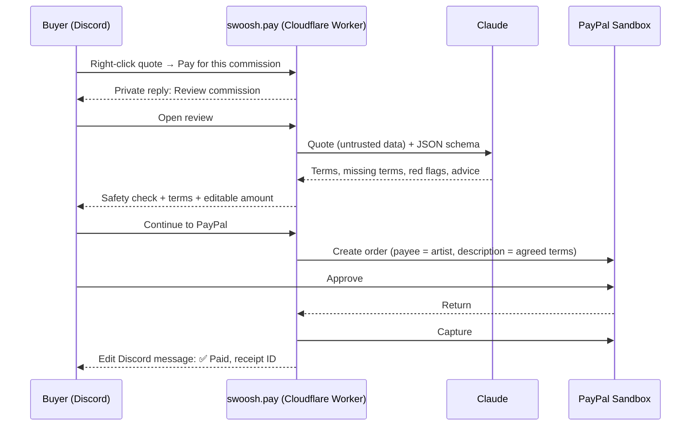

# swoosh.pay

**Pay anyone by their Discord handle, with an AI safety check before money moves.**

Art and creative commissions on Discord are agreed in a DM and paid by PayPal, often as "Friends and Family", to a username that might be a lookalike of the real artist. swoosh.pay turns that DM into a protected PayPal checkout: Claude reads the artist's quote, flags scam signals, and attaches the agreed terms to the PayPal order, so the receipt records what was bought.

**Live demo:** https://handlepay-sandbox.jadhav-rushikesh-ggl.workers.dev (PayPal Sandbox, test money only)

Built for the [PayPal AI Hackathon](https://paypalaihackathon.devpost.com/).

## What it does

| | |
|---|---|
| **AI commission review** | Right-click an artist's quote in a DM → **Apps → Pay for this commission**. Claude extracts deliverables, price, payment type, deadline and revisions, lists terms the quote leaves out, and flags PayPal-specific risks: requests to pay as Friends and Family, to pay outside PayPal, to pay someone else, or to hurry. swoosh.pay adds checks it can prove: the Discord account's age, lookalike handles of artists already paid, and payment history. |
| **Pay from Discord** | `/pay recipient:@artist amount:60` in a DM. If the artist has connected PayPal, one button opens PayPal checkout; the payment captures on return and the Discord message updates to "✅ Paid" with the PayPal receipt ID. |
| **Pay by username on the web** | Type a Discord username and amount. The username is verified with Discord before it is bound to an account. |
| **Invites for new artists** | If the artist hasn't connected PayPal, the sender shares a private invite. It only works for that exact Discord account, which then connects PayPal through PayPal Partner Referrals. |
| **One-tap repeat payments** *(built, waiting on PayPal Sandbox enablement)* | The first checkout saves the buyer's PayPal for that artist. Later, `/pay` shows **Confirm** in Discord and charges without a PayPal page, up to $500 per payment and $1,000 per day. See [Status](#status). |

## Try it

1. Open the [live demo](https://handlepay-sandbox.jadhav-rushikesh-ggl.workers.dev) and **Sign in with Discord**.
2. **Install Discord app** from the home page (it installs on your account, no server needed).
3. To receive payments, click **Connect PayPal** and log in with a PayPal **Sandbox business** account.
4. From a second Discord account, open a DM with the first and either:
   - run `/pay recipient:@them amount:5`, or
   - have the artist account send a quote such as *"full body character sheet, 2 poses, $5, done by Friday. can you send it as friends and family?"*, then right-click it → **Apps → Pay for this commission**.
5. Approve in PayPal with a Sandbox **personal** account. The Discord message updates with the receipt.

Sandbox logins for judges are in the Devpost submission.

## How it works



### AI

- **Model:** `claude-opus-5-5` through the official `@anthropic-ai/sdk`, at low effort. A review takes about 6–7 seconds behind a loading screen.
- **Structured output:** JSON schema output (`output_config.format`), normalized and validated again in `commission.mjs`.
- **Refusals:** the server-side refusal fallback is enabled (`fallbacks: "default"`).
- **Untrusted input:** the quote is treated as data; the system prompt tells Claude never to follow instructions inside it.
- **Claude can't block payments:** it never moves money and never blocks a payment. It explains risk, and the buyer decides and still approves in PayPal.
- **Graceful degradation:** if Claude is unavailable or declines, the page still shows swoosh.pay's own verifiable checks.

### PayPal

- **Partner Referrals** (`/v2/customer/partner-referrals`) to onboard artists as sellers, with `PAYMENT`, `REFUND`, `VAULT` and `BILLING_AGREEMENT` permissions.
- **Merchant integration status** checks that a seller can receive payments, has a confirmed email and granted capture permission before any order is created.
- **Orders v2** with `PayPal-Auth-Assertion` and `PayPal-Partner-Attribution-Id` for multiparty checkout. The seller is the payee, so the platform never holds funds. Idempotent `PayPal-Request-Id` on create and capture.
- **Webhooks** (`PAYMENT.CAPTURE.*`), verified with `/v1/notifications/verify-webhook-signature` and deduplicated, keep payment status current.
- **Vault** (`attributes.vault`, `usage_type: MERCHANT`) saves the buyer's PayPal on the artist's behalf for one-tap payments.

### Security

- Discord requests are verified with Ed25519 signatures and timestamps.
- OAuth state is single-use, and session cookies are `HttpOnly`.
- POST requests are checked for a same-origin `Origin` header, which blocks cross-site form submissions.
- A strict Content Security Policy applies, with no inline scripts or styles.
- Invites bind to Discord account IDs, not usernames.
- Webhooks are verified with PayPal before use.

## Status

- **Working in Sandbox:**
  - Discord and web payments, invites and seller onboarding;
  - automatic capture and webhook reconciliation;
  - the AI commission review;
  - Discord message updates.
- **One-tap repeat payments:**
  - Saving the buyer's PayPal for an artist works: the token comes back `VAULTED`.
  - Charging it with `vault_id` returns `422 PAYEE_ACCOUNT_INVALID` for onboarded Sandbox sellers. PayPal's docs note that only the platform's own Sandbox account is enabled for vaulting and that reference transactions need approval, and we've asked PayPal to enable it.
  - The app handles the failure safely: the Discord message says nothing was charged and offers checkout instead.
- **Next:** Telegram, milestone payments (a deposit now, the balance on delivery), and requiring sign-in before a PayPal wallet is saved.

## Run locally

Use Node.js 22.13 or later.

```sh
npm install
cp .env.example .env   # fill in Discord, PayPal Sandbox and Anthropic credentials
npm test               # integration tests with simulated Discord, PayPal and Claude
npm start              # http://localhost:8787, SQLite in data/handlepay.db
```

### Configuration

- **Discord:** create an application with a bot, enable **User Install** with the `applications.commands` scope, and set `DISCORD_APPLICATION_ID`, `DISCORD_CLIENT_SECRET`, `DISCORD_PUBLIC_KEY` and `DISCORD_BOT_TOKEN`.
  - Add `APP_ORIGIN/auth/discord/callback` as an OAuth2 redirect.
  - Set the Interactions Endpoint URL to `APP_ORIGIN/discord/interactions`.
  - Run `npm run discord:register` to register `/pay` and **Pay for this commission**.
- **PayPal:** use a Platforms-enabled Sandbox app and set `PAYPAL_CLIENT_ID`, `PAYPAL_CLIENT_SECRET`, `PAYPAL_PARTNER_MERCHANT_ID` and `PAYPAL_PARTNER_BN_CODE`.
  - Register `APP_ORIGIN/paypal/webhooks` for `PAYMENT.CAPTURE.COMPLETED`, `PENDING`, `DENIED` and `REFUNDED`, and set `PAYPAL_WEBHOOK_ID`.
- **Claude:** set `ANTHROPIC_API_KEY`.

### Deploy to Cloudflare

The Worker (`worker.mjs`) runs the same app on Cloudflare's Node HTTP adapter, with D1 instead of SQLite.

```sh
npx wrangler@4.156.0 d1 migrations apply DB --remote
npx wrangler@4.156.0 deploy
npx wrangler@4.156.0 secret put ANTHROPIC_API_KEY   # and the Discord / PayPal secrets
```

Values in `.env` are not sent to the Worker; set each one as a Wrangler secret.

## Built with

Node.js · Cloudflare Workers and D1 · Discord interactions (slash and message commands, user install) · PayPal Orders v2, Partner Referrals, Vault and Webhooks · Claude (`claude-opus-5-5`) via `@anthropic-ai/sdk`

## License

[MIT](LICENSE)
